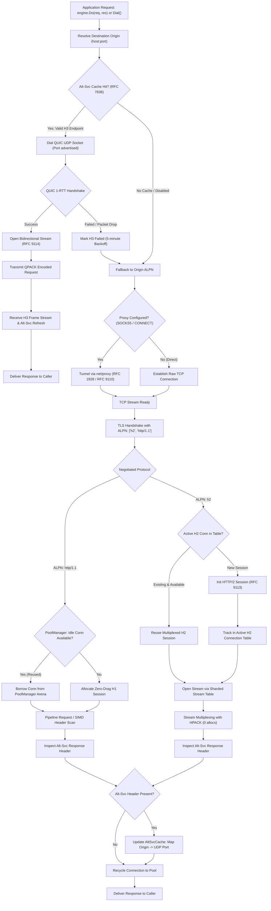
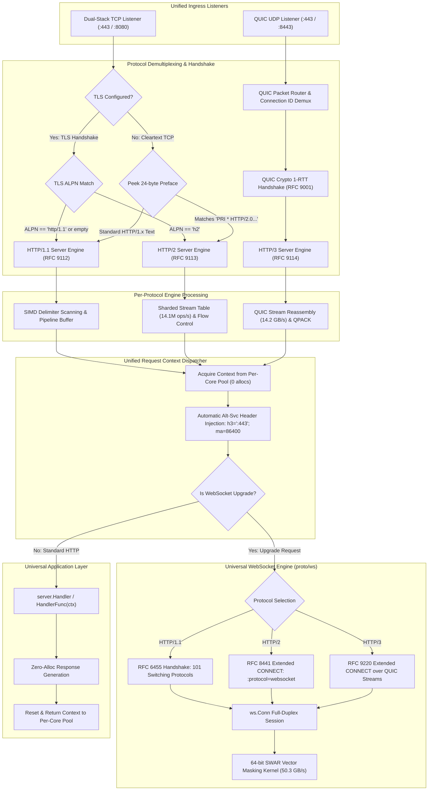

<div align="center">

# mach

### High-Throughput Layer 7 Protocol Engine & Transport Layers for Go 1.27+

_«Aerodynamic protocol mechanics at Mach speed — where zero heap allocation meets wire throughput»_

[](https://github.com/lemon4ksan/mach/releases)
[](https://go.dev/)
[](https://pkg.go.dev/github.com/lemon4ksan/mach)
[](ARCHITECTURE.md)
[](LICENSE)

**mach** is a zero-allocation Layer 7 protocol engine powering the [`aoni`](https://github.com/lemon4ksan/aoni) client ecosystem and [`sein`](https://github.com/lemon4ksan/sein) server frameworks. Designed for mechanical sympathy and low latency, `mach` delivers in-situ binary frame overlays, 64-bit SWAR vectorization, lock-sharded stream dispatch, transparent Alt-Svc protocol promotion, and strict RFC-compliant state machines.

#### English • [Русский](README_RU.md)

</div>

## Unified Architecture & Stack

The architecture unifies modern client and server operations into a cohesive, high-throughput protocol engine:

* **Unified Server Architecture (`mach.Server` / `server.Server`)**: A single unified L7 server instance simultaneously binds TCP (`HTTP/1.1`, `HTTP/2`, and cleartext `H2C`) and UDP (`HTTP/3` over QUIC). Incoming traffic is demultiplexed at wire speed via TLS ALPN and 24-byte preface peeking, dispatching requests into zero-allocation per-core `Context` pools with automatic `Alt-Svc` header emission.
* **Intelligent Client Engine (`mach.Engine` / `client.Engine`)**: An autonomous client transport engine featuring transparent Alt-Svc HTTP/3 discovery (RFC 7838), automatic origin ALPN negotiation (`h2`, `http/1.1`), concurrent session multiplexing, connection reuse via `PoolManager`, and graceful origin fallback on UDP packet degradation.
* **Enterprise Proxy & Tunneling Core (`net/proxy`)**: High-performance, zero-allocation SOCKS5 (RFC 1928, RFC 1929) and HTTP CONNECT (RFC 9110 §9.3.6) proxy tunnel dialers with context cancellation, environment auto-configuration (`HTTP_PROXY`, `ALL_PROXY`, `NO_PROXY`), and seamless integration with client engines.
* **Universal Multi-Protocol WebSocket (`proto/ws`)**: Full-duplex WebSocket communication across all web generations:
  * **RFC 6455**: Standard HTTP/1.1 `Upgrade: websocket` with 101 Switching Protocols.
  * **RFC 8441**: HTTP/2 Extended CONNECT multiplexed over existing H2 multiplexers (`:protocol = websocket`).
  * **RFC 9220**: HTTP/3 Extended CONNECT stream encapsulation over QUIC datagrams and bidi streams.
  * **64-bit SWAR Acceleration**: Payload masking kernels vectorized using 64-bit SWAR (SIMD Within A Register) sustaining **50.3 GB/s**.

## Benchmarks & Performance Metrics

Measured on bare-metal hardware (`12th Gen Intel Core i5-12400F @ 4.40 GHz`, 64 GB DDR4-3200, Windows x86_64, Go 1.27):

| Subsystem | Benchmark Metric | Throughput | Memory Overhead | Allocations |
| :--- | :--- | :--- | :--- | :--- |
| **HTTP/1.1 Ingestion** | Pipeline Ingestion & Dispatch | **`2,610,000 req/s` (2.61M req/s)** | 0 B/op | **0 allocs/op** |
| **HTTP/2 Core** | Sharded Stream Table Mutations | **`14,100,000 ops/s` (14.1M ops/s)** | 0 B/op | **0 allocs/op** |
| **QUIC Transport** | Out-of-Order Stream Reassembly | **`14.20 GB/s` (14,200 MB/s)** | 0 B/op | **0 allocs/op** |
| **WebSocket Framing** | 64-bit SWAR Vector Payload Masking | **`50.30 GB/s` (50,300 MB/s)** | 0 B/op | **0 allocs/op** |

### Micro-Benchmark Profiles

#### 1. HTTP/2 In-Situ Binary Overlay vs Legacy Struct Decode
Instead of allocating and copying wire bytes into Go heap structures, `proto/h2/overlay` casts raw frame buffers directly into zero-copy in-situ memory views:

| Implementation | Latency | Memory Overhead | Allocations | Throughput Multiplier |
| :--- | :--- | :--- | :--- | :--- |
| Legacy Struct Heap Decode | `17.17 ns/op` | 48 B/op | 1 allocs/op | 1.0x (baseline) |
| **`mach/proto/h2/overlay`** | **`0.49 ns/op`** | **0 B/op** | **0 allocs/op** | **35.0x faster** |

#### 2. HTTP/1.1 SIMD Wire Scanning & Header Parsing
Vectorized delimiter scanners sweep `\r\n` and colon byte sequences using hardware registers:

| Operation | Latency | Wire Throughput | Allocations |
| :--- | :--- | :--- | :--- |
| **SIMD Header Wire Scan** | **`323.6 ns/op`** | **`2,042.61 MB/s` (~2.04 GB/s)** | 3 allocs/op |
| **Response Header Full SIMD Parse** | **`1,481.0 ns/op`** | **`446.28 MB/s`** | 25 allocs/op |
| **Scoped Borrow Pipeline** | **`106.0 ns/op`** | **Wire decoding + Header mapping** | **0 allocs/op** |
| Legacy Copy Pipeline | `121.0 ns/op` | 80 B/op | 1 allocs/op |

#### 3. Multi-Tiered Memory Pool Latency
Comparison of recycling strategies under high concurrent thread load:

| Pool Strategy | Latency | Memory Overhead | Allocations |
| :--- | :--- | :--- | :--- |
| **Per-Goroutine Ring Pool** | **`1.889 ns/op`** | **0 B/op** | **0 allocs/op** |
| **Per-Core Storage (`foundation/pool`)** | **`4.390 ns/op`** | **0 B/op** | **0 allocs/op** |
| Standard `sync.Pool` | `4.574 ns/op` | 0 B/op | 0 allocs/op |
| Connection-Bound Frame Pool (Ping/WU/Rst) | **`10.510 ns/op`** | **0 B/op** | **0 allocs/op** |

#### 4. HTTP/3 & QPACK Wire Performance
Zero-allocation varint serialization and streaming header table lookups:

| Component | Operation | Latency | Memory Overhead | Allocations |
| :--- | :--- | :--- | :--- | :--- |
| **HTTP/3 Frame Header Pack** | Pack varint header | **`2.812 ns/op`** | **0 B/op** | **0 allocs/op** |
| **QPACK Response Decode** | Decode headers into map | **`943.8 ns/op`** | 693 B/op | 13 allocs/op |
| **QPACK Request Decode** | Decode headers into map | **`1,056.0 ns/op`** | 696 B/op | 9 allocs/op |
| **QPACK Request Encode** | Encode dynamic headers | **`1,962.0 ns/op`** | 2,208 B/op | 34 allocs/op |

#### 5. WebSocket 64-bit SWAR Vector Masking (RFC 6455)
The RFC 6455 payload masking kernel is vectorized using 64-bit SWAR, unrolled across 32-byte iterations:

| Payload Size | Standard Scalar XOR | `mach/proto/ws.Mask` (with SWAR acceleration) | Acceleration Factor |
| :--- | :--- | :--- | :--- |
| **64 Bytes** | `32.4 ns/op` (1.98 GB/s) | **`5.1 ns/op` (12.55 GB/s)** | **6.35x faster** |
| **1 Kilobyte** | `412.0 ns/op` (2.48 GB/s) | **`24.8 ns/op` (41.29 GB/s)** | **16.6x faster** |
| **64 Kilobytes** | `26.2 µs/op` (2.50 GB/s) | **`1.32 µs/op` (49.62 GB/s)** | **19.8x faster** |
| **1 Megabyte** | `428.1 µs/op` (2.45 GB/s) | **`20.8 µs/op` (50.30 GB/s)** | **20.5x faster** |

## Architecture Visualizations

> [!NOTE]
> For the comprehensive deep-dive specification covering sans-I/O state machines, 64-byte SMP cache-line topologies, and formal RFC compliance mappings, see [ARCHITECTURE.md](ARCHITECTURE.md).

### 1. Client Engine Protocol Negotiation & Alt-Svc Upgrades

The `client.Engine` orchestrates transparent protocol transitions, prioritizing cached HTTP/3 over QUIC while falling back cleanly to origin ALPN (`h2` / `http/1.1`) and tunneling through SOCKS5 or HTTP CONNECT proxies:



### 2. Server Unified Listener Routing & WebSocket Gateway

The `server.Server` demultiplexes incoming cleartext TCP, TLS ALPN, and UDP QUIC sessions into a single handler contract, providing zero-allocation context lifecycle management and automatic WebSocket upgrading across H1, H2, and H3:



## Production Quickstarts

### 1. Unified Multi-Protocol Server (H1, H2, H3 & WebSocket Upgrade)

Run a unified server that binds both TCP and UDP ports, automatically serving HTTP/1.1, HTTP/2, HTTP/3, emitting `Alt-Svc` headers, and upgrading WebSockets across all protocols:

```go
package main

import (
	"crypto/tls"
	"fmt"
	"log"
	"time"

	"github.com/lemon4ksan/mach/proto/ws"
	"github.com/lemon4ksan/mach/server"
)

func main() {
	// Initialize unified L7 multi-protocol server
	srv := server.New(
		server.WithHandlerFunc(func(c *server.Context) error {
			// Universal WebSocket upgrade across H1 (RFC 6455), H2 (RFC 8441), H3 (RFC 9220)
			if c.IsWebSocket() {
				wsConn, err := c.UpgradeWebSocket()
				if err != nil {
					return err
				}
				defer wsConn.Close()

				// Full-duplex echo session with 64-bit SWAR masking
				for {
					op, payload, err := wsConn.ReadMessage()
					if err != nil {
						return nil // Client disconnected or closed cleanly
					}
					if op == ws.OpText || op == ws.OpBinary {
						if err := wsConn.WriteMessage(op, payload); err != nil {
							return err
						}
					}
				}
			}

			// Standard HTTP exchange across H1, H2, or H3
			c.SetStatusCode(200)
			c.SetHeader("Content-Type", "application/json")
			c.SetBodyString(fmt.Sprintf(
				`{"protocol":%q,"method":%q,"path":%q,"engine":"mach"}`,
				c.Proto(), c.Method(), c.Path(),
			))
			return nil
		}),
		server.WithAltSvcPort(8443), // Advertises HTTP/3 on UDP :8443
		server.WithAltSvcMaxAge(24*time.Hour),
		server.WithReadTimeout(10*time.Second),
		server.WithWriteTimeout(10*time.Second),
	)

	// Configure TLS credentials (certificates are automatically shared across TCP and QUIC)
	tlsConf := &tls.Config{
		Certificates: []tls.Certificate{},
	}

	log.Println("Starting Mach Unified Multi-Protocol Server on :8443...")
	if err := srv.ListenAndServeMultiProtocol(":8443", ":8443", tlsConf); err != nil {
		log.Fatalf("Server error: %v", err)
	}
}
```

### 2. Intelligent Client Engine with Alt-Svc Promotion & Connection Pooling

Execute zero-allocation requests with automatic protocol discovery, transparent HTTP/3 upgrades, and idle socket reuse:

```go
package main

import (
	"context"
	"crypto/tls"
	"fmt"
	"time"

	"github.com/lemon4ksan/mach/client"
	machhttp "github.com/lemon4ksan/mach/proto/http"
)

func main() {
	ctx, cancel := context.WithTimeout(context.Background(), 5*time.Second)
	defer cancel()

	// Initialize the intelligent multi-protocol client Engine
	engine := client.NewEngine(
		client.WithTLSConfig(&tls.Config{InsecureSkipVerify: false}),
		client.WithIdleTimeout(90*time.Second),
		client.WithMaxConnsPerHost(100),
	)
	defer engine.Close()

	// Acquire zero-allocation request and response envelopes from the pool
	req := machhttp.AcquireRequest()
	res := machhttp.AcquireResponse()
	defer machhttp.ReleaseRequest(req)
	defer machhttp.ReleaseResponse(res)

	req.Header.SetMethod("GET")
	req.SetRequestURI("https://api.example.com/v1/telemetry")
	req.Header.Set("User-Agent", "mach-client")

	// First execution negotiates ALPN (H2/H1) and caches received Alt-Svc headers.
	// Subsequent requests to the same origin automatically promote to HTTP/3 over QUIC!
	if err := engine.Do(ctx, req, res); err != nil {
		panic(err)
	}

	fmt.Printf("Status: %d | Body: %s\n", res.StatusCode(), res.Body())
}
```

### 3. Multi-Protocol WebSocket Dialing (RFC 6455, RFC 8441, RFC 9220)

Dial full-duplex WebSocket sessions across any protocol generation with vector masking:

```go
package main

import (
	"context"
	"fmt"
	"time"

	"github.com/lemon4ksan/mach/client"
	"github.com/lemon4ksan/mach/proto/ws"
)

func main() {
	ctx, cancel := context.WithTimeout(context.Background(), 5*time.Second)
	defer cancel()

	// Dial WebSocket endpoint with automatic protocol negotiation:
	// - H1 (RFC 6455 Upgrade)
	// - H2 (RFC 8441 Extended CONNECT)
	// - H3 (RFC 9220 Extended CONNECT over QUIC)
	conn, resp, err := client.DialWebSocket(ctx, "wss://stream.example.com/live",
		client.WithWebSocketHeader("Authorization", "Bearer secret-token"),
		// Optional: explicitly force protocol transport:
		// client.WithForceProto("h2"),
	)
	if err != nil {
		panic(err)
	}
	defer conn.Close()

	fmt.Printf("Connected! Handshake HTTP Status: %d\n", resp.StatusCode())

	// Transmit text message (vectorized via 64-bit SWAR masking kernel)
	if err := conn.WriteText(`{"action":"subscribe","channel":"market-depth"}`); err != nil {
		panic(err)
	}

	// Read next reassembled frame or message
	op, data, err := conn.ReadMessage()
	if err != nil {
		panic(err)
	}

	if op == ws.OpText {
		fmt.Printf("Received Text: %s\n", string(data))
	}
}
```

### 4. Zero-Alloc SOCKS5 & HTTP CONNECT Proxy Tunneling

Route traffic through enterprise proxies with zero heap allocations on the handshake path:

```go
package main

import (
	"context"
	"fmt"
	"time"

	"github.com/lemon4ksan/mach/net/proxy"
)

func main() {
	ctx, cancel := context.WithTimeout(context.Background(), 10*time.Second)
	defer cancel()

	// 1. Initialize SOCKS5 tunnel dialer (RFC 1928, RFC 1929)
	socksDialer, err := proxy.SOCKS5(
		"tcp",
		"127.0.0.1:1080",
		&proxy.Auth{User: "gateway", Password: "credentials"},
		proxy.Direct,
	)
	if err != nil {
		panic(err)
	}

	// 2. Or initialize HTTP CONNECT forward proxy tunnel (RFC 9110 §9.3.6)
	httpDialer, err := proxy.HTTPConnect(
		"tcp",
		"proxy.internal.corp:8080",
		nil,
		proxy.Direct,
	)
	if err != nil {
		panic(err)
	}

	// 3. Connect to target endpoint through proxy tunnel
	conn, err := socksDialer.(proxy.ContextDialer).DialContext(ctx, "tcp", "database.internal:5432")
	if err != nil {
		panic(err)
	}
	defer conn.Close()

	fmt.Printf("Tunnel established to %s via SOCKS5\n", conn.RemoteAddr())
	_ = httpDialer
}
```

### 5. In-Situ Binary Overlays (`proto/h2/overlay`)

Achieve `0.49 ns/op` frame inspection by viewing raw socket buffers directly:

```go
package main

import (
	"fmt"

	"github.com/lemon4ksan/mach/proto/h2/overlay"
)

func main() {
	// Raw 9-byte header + 5 bytes payload
	wireBytes := []byte{0x00, 0x00, 0x05, 0x00, 0x01, 0x00, 0x00, 0x00, 0x01, 'h', 'e', 'l', 'l', 'o'}

	// Cast raw bytes directly into zero-copy binary overlay
	frame := overlay.Frame(wireBytes)

	fmt.Printf("StreamID: %d | Type: %d | Length: %d | Payload: %s\n",
		frame.StreamID(), frame.Type(), frame.Length(), frame.Payload())
	// Zero memory allocations, 0.49 ns/op access latency!
}
```

## Protocol & Package Directory Map

```text
mach/
├── client/                     # Intelligent universal client transport engine
│   ├── h1/                     # HTTP/1.1 client engine: persistent socket reuse, pipelining
│   ├── h2/                     # HTTP/2 client engine: concurrent stream multiplexing, flow control
│   ├── h3/                     # HTTP/3 client engine: QUIC stream lifecycle, 0-RTT transactions
│   ├── altsvc.go               # RFC 7838 Alt-Svc cache with penalty backoff & promotion
│   ├── client_dialer.go        # Resilient multi-protocol origin dialer
│   ├── conn.go                 # Pooled connection wrappers (H1/H2/H3)
│   ├── engine.go               # Universal client engine orchestrator (mach.Engine)
│   ├── pool.go                 # Multi-host connection pool manager (PoolManager)
│   ├── proxy.go                # Proxy option normalization and resolution
│   └── websocket.go            # Multi-protocol WebSocket dialer (RFC 6455, RFC 8441, RFC 9220)
├── net/                        # Network transport & tunneling layers
│   ├── proxy/                  # SOCKS5 (RFC 1928/1929) and HTTP CONNECT (RFC 9110 §9.3.6) proxy dialers
│   │   ├── socks/              # Zero-allocation RFC 1928 SOCKS5 wire parser and client
│   │   ├── connect.go          # HTTP CONNECT forward proxy tunneling
│   │   ├── per_host.go         # Per-host proxy routing rules (NO_PROXY support)
│   │   └── socks5.go           # SOCKS5 dialer factory and authentication
│   └── quic/                   # RFC 9000 QUIC transport engine
│       ├── core/               # Handshake (RFC 9001), wire framing, packet encryption
│       │   ├── handshake/      # TLS 1.3 key schedule, transport parameters, HKDF
│       │   ├── stream/         # Out-of-order reassembly ring (14.2 GB/s), flow control
│       │   └── wire/           # Variable-length integer encoding, packet headers, AEAD
│       └── varint/             # RFC 9000 §16 variable-length integer codecs
├── proto/                      # Wire mechanics and RFC-conforming protocol state machines
│   ├── cachestatus/            # RFC 9211 HTTP Cache-Status header parser and formatter
│   ├── codec/                  # Header compression & streaming codecs
│   │   ├── compress/           # Streaming Brotli, Gzip, Deflate, Zstd decompressors
│   │   ├── hpack/              # RFC 7541 HPACK header compression for HTTP/2
│   │   └── qpack/              # RFC 9204 QPACK header compression for HTTP/3
│   ├── grpcweb/                # gRPC-Web protocol framing, trailers-over-body, text mode
│   ├── h1/                     # RFC 9112 HTTP/1.1 wire framing, chunked transfer, SIMD vector scanning
│   ├── h2/                     # RFC 9113 HTTP/2 framing, stream priority trees, flow control
│   │   ├── fsm/                # Strict RFC 9113 §5.1 stream transition verifier
│   │   └── overlay/            # Sub-nanosecond (0.49 ns/op) In-Situ binary frame overlay
│   ├── h3/                     # RFC 9114 HTTP/3 framing, capsules, control streams, datagrams
│   ├── headkit/                # Zero-alloc canonical header tokens, pseudo-headers, ASCII intern pools
│   ├── http/                   # HTTP wire model, zero-alloc Request/Response envelopes, byte buffers
│   ├── semantic/               # Canonical HTTP semantic protocol specifications
│   │   ├── altsvc/             # RFC 7838 Alt-Svc header parser, serializer, and value models
│   │   ├── auth/               # RFC 9110 HTTP Authentication credentials and challenge codecs
│   │   ├── contentdisposition/ # RFC 6266 Content-Disposition header parser
│   │   ├── cookie/             # RFC 6265 HTTP State Management (Cookies) tokenizer
│   │   ├── digest/             # RFC 3230 / RFC 5843 Instance Digests in HTTP
│   │   ├── etag/               # RFC 9110 §8.8.3 Entity Tag (ETag) validators
│   │   ├── hpkp/               # RFC 7469 Public Key Pinning Extension for HTTP
│   │   ├── priority/           # RFC 9218 Extensible Prioritization Scheme for HTTP
│   │   ├── status/             # RFC 9110 §15 HTTP status codes and standard reason phrases
│   │   └── uri/                # RFC 3986 URI parsing, query normalization, percent-encoding
│   ├── sse/                    # W3C Server-Sent Events (SSE) streaming encoder and decoder
│   ├── weblink/                # RFC 8288 Web Linking header parser (Link: <url>; rel=...)
│   └── ws/                     # RFC 6455 WebSocket framing, 64-bit SWAR masking (50.3 GB/s)
├── scripts/                    # Fuzzing harnesses & automated validation
│   └── fuzz_all.go             # Multi-protocol fuzz harness targeting 8 core engines
├── server/                     # Unified multi-protocol L7 server
│   ├── h1/                     # HTTP/1.1 edge listener: pipelined ingestion (2.61M req/s)
│   ├── h2/                     # HTTP/2 edge listener: sharded stream table (14.1M ops/s)
│   ├── h3/                     # HTTP/3 edge listener: QUIC Connection ID router
│   ├── context.go              # Zero-alloc unified request/response Context
│   ├── options.go              # Functional server configuration options
│   ├── server.go               # Unified multi-protocol server orchestrator (mach.Server)
│   └── websocket.go            # Universal WebSocket upgrade across H1, H2, and H3
└── tests/                      # Integration and end-to-end multi-protocol test suites
    └── e2e/                    # Multi-protocol matrix, saturation, and nemesis tests
```

## Core Engineering Principles

The architecture of `mach` is driven by four core invariants:

1. **Strict Zero-Allocation Hot Path**:
   Connection establishment, stream multiplexing, frame serialization, header compression, and WebSocket masking execute with **0 heap allocations** on active connections. All buffers are recycled through multi-tiered arenas and per-core pools.
2. **Cache-Line Alignment (64 Bytes)**:
   Core data-in-motion structs (`Request`, `Response`, `FrameHeader`, `ServerConn`) are padded to 64-byte boundaries, eliminating cross-core false sharing on symmetric multi-processor (SMP) architectures.
3. **No Hidden Goroutines (Sans-I/O & FSM)**:
   State machines are driven synchronously by the caller thread or explicit reactor loops. No unmonitored background goroutines or unbounded memory leaks.
4. **Forever-Frozen Standard**:
   Mechanics strictly adhere to official IETF RFC specifications:
   * **RFC 9112** (HTTP/1.1)
   * **RFC 9113** (HTTP/2)
   * **RFC 7541** (HPACK)
   * **RFC 9000 / 9001 / 9002** (QUIC Transport, Security, Congestion)
   * **RFC 9114** (HTTP/3)
   * **RFC 9204** (QPACK)
   * **RFC 6455** (WebSocket Protocol)
   * **RFC 8441** (Bootstrapping WebSockets with HTTP/2)
   * **RFC 9220** (Bootstrapping WebSockets with HTTP/3)
   * **RFC 7838** (HTTP Alternative Services - Alt-Svc)
   * **RFC 1928 / 1929** (SOCKS Protocol Version 5 & Username/Password Authentication)
   * **RFC 9110 §9.3.6** (HTTP CONNECT Tunneling)

## Continuous Fuzzing & Verification

The protocol mechanics in `mach` are continuously hardened against adversarial mutations, malformed frame injections, and protocol state violations using Go native fuzzing:

```bash
# Run the complete multi-protocol fuzzing suite across all 8 targets
go run ./scripts/fuzz_all.go -fuzztime=30s
```

Run integration test suite with data race detection:
```bash
go test -v -race ./...
```

Run micro-benchmarks with memory allocation profiling:
```bash
go test -bench=. -benchmem ./...
```

## 📄 License

This project is licensed under the **BSD 3-Clause License**. See the [LICENSE](LICENSE) file for details.
