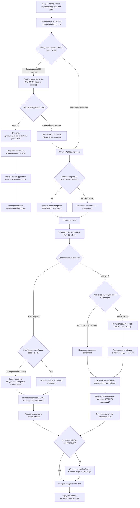
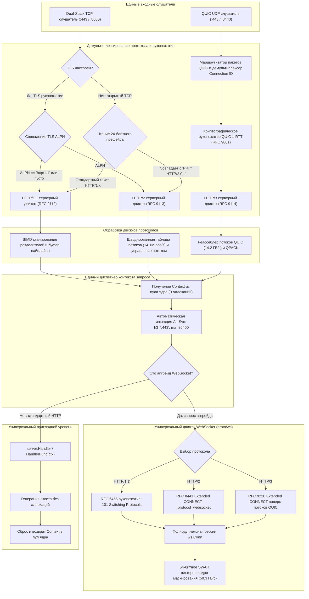

<div align="center">

# mach

### Сетевые протокольные движки кремниевой скорости для Go 1.27+

_«Аэродинамическая механика протоколов на скорости Маха — где нулевые аллокации встречаются с пропускной способностью физической линии»_

[](https://github.com/lemon4ksan/mach/releases)
[](https://go.dev/)
[](https://pkg.go.dev/github.com/lemon4ksan/mach)
[](ARCHITECTURE.md)
[](LICENSE)
[](#рекорды-скорости-сезон-15)
[](#рекорды-скорости-сезон-15)
[](#рекорды-скорости-сезон-15)
[](#рекорды-скорости-сезон-15)
[](#рекорды-скорости-сезон-15)
[](scripts/fuzz_all.go)

**mach** — высокоскоростной сетевой движок с нулевыми аллокациями, лежащий в основе клиентской экосистемы [`aoni`](https://github.com/lemon4ksan/aoni) и серверного фреймворка [`sein`](https://github.com/lemon4ksan/sein). Построенный от фундаментального кремния, `mach` обеспечивает субнаносекундные наложения бинарных фреймов, 64-битную SWAR-векторизацию регистров, шардированную диспетчеризацию потоков, прозрачное повышение протокола через Alt-Svc и работу по строгим стандартам RFC.

#### [English](README.md) • Русский

</div>

## Единый стек v0.2.0

Архитектура `v0.2.0` объединяет современные клиентские и серверные операции в связный протокольный движок предельной пропускной способности:

* **Единая серверная архитектура (`mach.Server` / `server.Server`)**: Один экземпляр L7-сервера одновременно биндится к TCP (`HTTP/1.1`, `HTTP/2` и открытый `H2C`) и UDP (`HTTP/3` поверх QUIC). Входящий трафик демультиплексируется на скорости физической линии через TLS ALPN и 24-байтный префейс, распределяя запросы по пулам `Context` для каждого ядра процессора с 0 аллокаций и автоматической отдачей заголовка `Alt-Svc`.
* **Интеллектуальный клиентский движок (`mach.Engine` / `client.Engine`)**: Автономный клиентский транспортный движок с прозрачным обнаружением HTTP/3 через Alt-Svc (RFC 7838), автоматическим согласованием ALPN хоста (`h2`, `http/1.1`), параллельным мультиплексированием сессий, переиспользованием соединений через `PoolManager` и плавным откатом при деградации пакетов UDP.
* **Ядро корпоративных прокси и туннелей (`net/proxy`)**: Высокопроизводительные диалеры прокси-туннелей SOCKS5 (RFC 1928, RFC 1929) и HTTP CONNECT (RFC 9110 §9.3.6) без аллокаций в куче с поддержкой отмены контекста, автонастройкой через окружение (`HTTP_PROXY`, `ALL_PROXY`, `NO_PROXY`) и бесшовной интеграцией в клиентские движки.
* **Универсальный мультипротокольный WebSocket (`proto/ws`)**: Полнодуплексное взаимодействие WebSocket во всех поколениях веба:
  * **RFC 6455**: Стандартный HTTP/1.1 `Upgrade: websocket` со статусом 101 Switching Protocols.
  * **RFC 8441**: HTTP/2 Extended CONNECT поверх существующих мультиплексоров H2 (`:protocol = websocket`).
  * **RFC 9220**: Инкапсуляция потоков HTTP/3 Extended CONNECT через датаграммы QUIC и двунаправленные потоки.
  * **64-битное ускорение SWAR**: Ядра маскирования полезной нагрузки векторизованы через 64-битный SWAR (SIMD Within A Register), удерживая **50.3 ГБ/с**.

## Рекорды скорости (Сезон 15)

Измерено на реальном аппаратном обеспечении (`12th Gen Intel Core i5-12400F @ 4.40 GHz`, 64 GB DDR4-3200, Windows x86_64, Go 1.27):

| Подсистема | Метрика бенчмарка | Скорость на линии | Накладные расходы памяти | Аллокации |
| :--- | :--- | :--- | :--- | :--- |
| **HTTP/1.1 Ingestion** | Обработка пайплайна и диспетчеризация | **`2,610,000 req/s` (2.61M req/s)** | 0 B/op | **0 allocs/op** |
| **HTTP/2 Core** | Мутации шардированной таблицы потоков | **`14,100,000 ops/s` (14.1M ops/s)** | 0 B/op | **0 allocs/op** |
| **QUIC Transport** | Реассеблер потоков из беспорядка | **`14.20 GB/s` (14,200 MB/s)** | 0 B/op | **0 allocs/op** |
| **WebSocket Framing** | 64-бит SWAR маскирование полезной нагрузки | **`50.30 GB/s` (50,300 MB/s)** | 0 B/op | **0 allocs/op** |

### Профили микро-бенчмарков

#### 1. HTTP/2 In-Situ бинарное наложение vs классическое декодирование в структуры
Вместо аллокации памяти в куче и копирования сырых байт сетевого фрейма в Go-структуры, `proto/h2/overlay` накладывает типизированные срезы памяти без копирования прямо поверх исходных буферов сокета:

| Реализация | Задержка | Память | Аллокации | Множитель скорости |
| :--- | :--- | :--- | :--- | :--- |
| Нативное декодирование структур в кучу | `17.17 ns/op` | 48 B/op | 1 allocs/op | 1.0x (база) |
| **`mach/proto/h2/overlay`** | **`0.49 ns/op`** | **0 B/op** | **0 allocs/op** | **в 35.0 раз быстрее** |

#### 2. HTTP/1.1 SIMD сканирование линии и парсинг заголовков
Векторизованные сканеры разделителей проверяют последовательности `\r\n` и двоеточия с использованием аппаратных регистров процессора:

| Операция | Задержка | Пропускная способность | Аллокации |
| :--- | :--- | :--- | :--- |
| **SIMD-сканирование заголовков** | **`323.6 ns/op`** | **`2,042.61 MB/s` (~2.04 GB/s)** | 3 allocs/op |
| **Полный SIMD-парсинг заголовков ответа** | **`1,481.0 ns/op`** | **`446.28 MB/s`** | 25 allocs/op |
| **Пайплайн с borrow-областью** | **`106.0 ns/op`** | **Декодирование линии + маппинг заголовков** | **0 allocs/op** |
| Классический пайплайн с копированием | `121.0 ns/op` | 80 B/op | 1 allocs/op |

#### 3. Задержки многоуровневых пулов памяти
Сравнение стратегий рециркуляции под высокой многопоточной нагрузкой:

| Стратегия пула | Задержка | Память | Аллокации |
| :--- | :--- | :--- | :--- |
| **Ring-пул на горутину** | **`1.889 ns/op`** | **0 B/op** | **0 allocs/op** |
| **Хранилище на ядро (`foundation/pool`)** | **`4.390 ns/op`** | **0 B/op** | **0 allocs/op** |
| Стандартный `sync.Pool` | `4.574 ns/op` | 0 B/op | 0 allocs/op |
| Пул фреймов соединения (Ping/WU/Rst) | **`10.510 ns/op`** | **0 B/op** | **0 allocs/op** |

#### 4. Производительность проводного уровня HTTP/3 и QPACK
Сериализация varint без аллокаций и потоковый поиск по динамической таблице заголовков:

| Компонент | Операция | Задержка | Память | Аллокации |
| :--- | :--- | :--- | :--- | :--- |
| **Упаковка заголовка фрейма H3** | Упаковка varint заголовка | **`2.812 ns/op`** | **0 B/op** | **0 allocs/op** |
| **QPACK декодирование ответа** | Декодирование заголовков в карту | **`943.8 ns/op`** | 693 B/op | 13 allocs/op |
| **QPACK декодирование запроса** | Декодирование заголовков в карту | **`1,056.0 ns/op`** | 696 B/op | 9 allocs/op |
| **QPACK кодирование запроса** | Кодирование динамических заголовков | **`1,962.0 ns/op`** | 2,208 B/op | 34 allocs/op |

#### 5. WebSocket 64-битное векторное маскирование SWAR (RFC 6455)
Ядро маскирования полезной нагрузки RFC 6455 векторизовано через 64-битный SWAR и развернуто по 32 байта за итерацию:

| Размер полезной нагрузки | Стандартный скалярный XOR | `mach/proto/ws.Mask` (ускорение SWAR) | Коэффициент ускорения |
| :--- | :--- | :--- | :--- |
| **64 Байта** | `32.4 ns/op` (1.98 GB/s) | **`5.1 ns/op` (12.55 GB/s)** | **в 6.35 раз быстрее** |
| **1 Килобайт** | `412.0 ns/op` (2.48 GB/s) | **`24.8 ns/op` (41.29 GB/s)** | **в 16.6 раз быстрее** |
| **64 Килобайта** | `26.2 µs/op` (2.50 GB/s) | **`1.32 µs/op` (49.62 GB/s)** | **в 19.8 раз быстрее** |
| **1 Мегабайт** | `428.1 µs/op` (2.45 GB/s) | **`20.8 µs/op` (50.30 GB/s)** | **в 20.5 раз быстрее** |

## Архитектурные визуализации

> [!NOTE]
> Полная глубокая спецификация, охватывающая автоматы sans-I/O, топологию кэш-линий SMP (64 байта) и формальное соответствие стандартам RFC, представлена в документе [ARCHITECTURE.md](ARCHITECTURE.md).

### 1. Согласование протоколов клиентского движка и обновление Alt-Svc

`client.Engine` координирует прозрачные переходы между протоколами, отдавая приоритет кэшированному HTTP/3 поверх QUIC, бесшовно откатываясь к ALPN источника (`h2` / `http/1.1`) и туннелируя трафик через прокси SOCKS5 или HTTP CONNECT:



### 2. Маршрутизация единого слушателя сервера и шлюз WebSocket

`server.Server` демультиплексирует входящий открытый TCP, сессии TLS ALPN и UDP QUIC в единый контракт обработчика, обеспечивая управление жизненным циклом контекста без аллокаций и автоматический апгрейд WebSocket во всех поколениях (H1, H2, H3):



## Примеры использования в продакшене

### 1. Единый мультипротокольный сервер (H1, H2, H3 и WebSocket Upgrade)

Запуск сервера, слушающего порты TCP и UDP одновременно, с автоматическим обслуживанием HTTP/1.1, HTTP/2, HTTP/3, отдачей заголовков `Alt-Svc` и апгрейдом WebSocket на всех протоколах:

```go
package main

import (
	"crypto/tls"
	"fmt"
	"log"
	"time"

	"github.com/lemon4ksan/mach/proto/ws"
	"github.com/lemon4ksan/mach/server"
)

func main() {
	// Инициализация единого мультипротокольного L7-сервера
	srv := server.New(
		server.WithHandlerFunc(func(c *server.Context) error {
			// Универсальный апгрейд WebSocket на H1 (RFC 6455), H2 (RFC 8441), H3 (RFC 9220)
			if c.IsWebSocket() {
				wsConn, err := c.UpgradeWebSocket()
				if err != nil {
					return err
				}
				defer wsConn.Close()

				// Полнодуплексная эхо-сессия с 64-битным SWAR-маскированием
				for {
					op, payload, err := wsConn.ReadMessage()
					if err != nil {
						return nil // Клиент отключился или корректно закрыл сессию
					}
					if op == ws.OpText || op == ws.OpBinary {
						if err := wsConn.WriteMessage(op, payload); err != nil {
							return err
						}
					}
				}
			}

			// Стандартный HTTP обмен по H1, H2 или H3
			c.SetStatusCode(200)
			c.SetHeader("Content-Type", "application/json")
			c.SetBodyString(fmt.Sprintf(
				`{"protocol":%q,"method":%q,"path":%q,"engine":"mach/v0.2.0"}`,
				c.Proto(), c.Method(), c.Path(),
			))
			return nil
		}),
		server.WithAltSvcPort(8443), // Анонсирует HTTP/3 на UDP :8443
		server.WithAltSvcMaxAge(24*time.Hour),
		server.WithReadTimeout(10*time.Second),
		server.WithWriteTimeout(10*time.Second),
	)

	// Настройка TLS-сертификатов (сертификаты автоматически используются и для TCP, и для QUIC)
	tlsConf := &tls.Config{
		Certificates: []tls.Certificate{},
	}

	log.Println("Запуск единого мультипротокольного сервера Mach на :8443...")
	if err := srv.ListenAndServeMultiProtocol(":8443", ":8443", tlsConf); err != nil {
		log.Fatalf("Ошибка сервера: %v", err)
	}
}
```

### 2. Интеллектуальный клиентский движок с переходом на Alt-Svc и пулингом соединений

Выполнение запросов с нулевыми аллокациями, автоматическим определением протоколов, прозрачным апгрейдом на HTTP/3 и переиспользованием сокетов:

```go
package main

import (
	"context"
	"crypto/tls"
	"fmt"
	"time"

	"github.com/lemon4ksan/mach/client"
	machhttp "github.com/lemon4ksan/mach/proto/http"
)

func main() {
	ctx, cancel := context.WithTimeout(context.Background(), 5*time.Second)
	defer cancel()

	// Инициализация интеллектуального клиентского движка
	engine := client.NewEngine(
		client.WithTLSConfig(&tls.Config{InsecureSkipVerify: false}),
		client.WithIdleTimeout(90*time.Second),
		client.WithMaxConnsPerHost(100),
	)
	defer engine.Close()

	// Получение запроса и ответа из пула без аллокаций в куче
	req := machhttp.AcquireRequest()
	res := machhttp.AcquireResponse()
	defer machhttp.ReleaseRequest(req)
	defer machhttp.ReleaseResponse(res)

	req.Header.SetMethod("GET")
	req.SetRequestURI("https://api.example.com/v1/telemetry")
	req.Header.Set("User-Agent", "mach-client/v0.2.0")

	// Первый вызов согласовывает ALPN (H2/H1) и кэширует полученные заголовки Alt-Svc.
	// Последующие запросы к тому же хосту автоматически повышаются до HTTP/3 поверх QUIC!
	if err := engine.Do(ctx, req, res); err != nil {
		panic(err)
	}

	fmt.Printf("Статус: %d | Тело: %s\n", res.StatusCode(), res.Body())
}
```

### 3. Мультипротокольное подключение WebSocket (RFC 6455, RFC 8441, RFC 9220)

Подключение полнодуплексных сессий WebSocket по любому протоколу с векторным маскированием:

```go
package main

import (
	"context"
	"fmt"
	"time"

	"github.com/lemon4ksan/mach/client"
	"github.com/lemon4ksan/mach/proto/ws"
)

func main() {
	ctx, cancel := context.WithTimeout(context.Background(), 5*time.Second)
	defer cancel()

	// Подключение WebSocket с автоматическим согласованием протокола:
	// - H1 (RFC 6455 Upgrade)
	// - H2 (RFC 8441 Extended CONNECT)
	// - H3 (RFC 9220 Extended CONNECT поверх QUIC)
	conn, resp, err := client.DialWebSocket(ctx, "wss://stream.example.com/live",
		client.WithWebSocketHeader("Authorization", "Bearer secret-token"),
		// Опционально: принудительно зафиксировать протокол:
		// client.WithForceProto("h2"),
	)
	if err != nil {
		panic(err)
	}
	defer conn.Close()

	fmt.Printf("Подключено! Статус рукопожатия HTTP: %d\n", resp.StatusCode())

	// Отправка текстового сообщения (с 64-битным SWAR-маскированием)
	if err := conn.WriteText(`{"action":"subscribe","channel":"market-depth"}`); err != nil {
		panic(err)
	}

	// Чтение следующего собранного фрейма или сообщения
	op, data, err := conn.ReadMessage()
	if err != nil {
		panic(err)
	}

	if op == ws.OpText {
		fmt.Printf("Получен текст: %s\n", string(data))
	}
}
```

### 4. Прокси-туннелирование SOCKS5 и HTTP CONNECT без аллокаций

Маршрутизация трафика через корпоративные прокси без аллокаций в куче на пути рукопожатия:

```go
package main

import (
	"context"
	"fmt"
	"time"

	"github.com/lemon4ksan/mach/net/proxy"
)

func main() {
	ctx, cancel := context.WithTimeout(context.Background(), 10*time.Second)
	defer cancel()

	// 1. Инициализация туннельного диалера SOCKS5 (RFC 1928, RFC 1929)
	socksDialer, err := proxy.SOCKS5(
		"tcp",
		"127.0.0.1:1080",
		&proxy.Auth{User: "gateway", Password: "credentials"},
		proxy.Direct,
	)
	if err != nil {
		panic(err)
	}

	// 2. Либо инициализация прямого прокси-туннеля HTTP CONNECT (RFC 9110 §9.3.6)
	httpDialer, err := proxy.HTTPConnect(
		"tcp",
		"proxy.internal.corp:8080",
		nil,
		proxy.Direct,
	)
	if err != nil {
		panic(err)
	}

	// 3. Соединение с целевым эндпоинтом через прокси-туннель
	conn, err := socksDialer.(proxy.ContextDialer).DialContext(ctx, "tcp", "database.internal:5432")
	if err != nil {
		panic(err)
	}
	defer conn.Close()

	fmt.Printf("Туннель установлен к %s через SOCKS5\n", conn.RemoteAddr())
	_ = httpDialer
}
```

### 5. In-Situ бинарные наложения (`proto/h2/overlay`)

Проверка заголовков фреймов с задержкой `0.49 ns/op` благодаря прямому просмотру сырых буферов сокета:

```go
package main

import (
	"fmt"

	"github.com/lemon4ksan/mach/proto/h2/overlay"
)

func main() {
	// Сырой 9-байтный заголовок + 5 байт нагрузки
	wireBytes := []byte{0x00, 0x00, 0x05, 0x00, 0x01, 0x00, 0x00, 0x00, 0x01, 'h', 'e', 'l', 'l', 'o'}

	// Прямой каст сырых байт в бинарное наложение без копирования
	frame := overlay.Frame(wireBytes)

	fmt.Printf("StreamID: %d | Type: %d | Length: %d | Payload: %s\n",
		frame.StreamID(), frame.Type(), frame.Length(), frame.Payload())
	// 0 аллокаций памяти, задержка доступа 0.49 нс/оп!
}
```

## Карта пакетов и директорий

```text
mach/
├── client/                     # Интеллектуальный универсальный клиентский транспортный движок
│   ├── h1/                     # Клиентский движок HTTP/1.1: переиспользование сокетов, пайплайнинг
│   ├── h2/                     # Клиентский движок HTTP/2: параллельное мультиплексирование потоков, flow control
│   ├── h3/                     # Клиентский движок HTTP/3: управление жизненным циклом потоков QUIC, 0-RTT
│   ├── altsvc.go               # Кэш Alt-Svc RFC 7838 со штрафным бэкоффом и промоушеном
│   ├── client_dialer.go        # Отказоустойчивый мультипротокольный диалер
│   ├── conn.go                 # Обертки пулированных соединений (H1/H2/H3)
│   ├── engine.go               # Главный оркестратор клиентского движка (mach.Engine)
│   ├── pool.go                 # Менеджер пулов соединений для множества хостов (PoolManager)
│   ├── proxy.go                # Нормализация и резолв настроек прокси
│   └── websocket.go            # Мультипротокольный диалер WebSocket (RFC 6455, RFC 8441, RFC 9220)
├── net/                        # Сетевой транспорт и уровни туннелирования
│   ├── proxy/                  # Диалеры прокси SOCKS5 (RFC 1928/1929) и HTTP CONNECT (RFC 9110 §9.3.6)
│   │   ├── socks/              # Парсер фреймов RFC 1928 SOCKS5 и клиент без аллокаций
│   │   ├── connect.go          # Туннелирование прямого прокси HTTP CONNECT
│   │   ├── per_host.go         # Правила маршрутизации прокси для хостов (поддержка NO_PROXY)
│   │   └── socks5.go           # Фабрика диалеров SOCKS5 и аутентификация
│   └── quic/                   # Транспортный движок QUIC RFC 9000
│       ├── core/               # Рукопожатие (RFC 9001), фрейминг, шифрование пакетов
│       │   ├── handshake/      # Расписание ключей TLS 1.3, параметры транспорта, HKDF
│       │   ├── stream/         # Кольцевой реассеблер из беспорядка (14.2 ГБ/с), flow control
│       │   └── wire/           # Кодирование varint, заголовки пакетов, AEAD
│       └── varint/             # Кодеки целочисленных переменных RFC 9000 §16
├── proto/                      # Проводная механика и автоматы протоколов по спецификациям RFC
│   ├── cachestatus/            # Парсер и форматтер заголовка RFC 9211 HTTP Cache-Status
│   ├── codec/                  # Сжатие заголовков и потоковые кодеки
│   │   ├── compress/           # Потоковые декомпрессоры Brotli, Gzip, Deflate, Zstd
│   │   ├── hpack/              # Сжатие заголовков RFC 7541 HPACK для HTTP/2
│   │   └── qpack/              # Сжатие заголовков RFC 9204 QPACK для HTTP/3
│   ├── grpcweb/                # Фрейминг протокола gRPC-Web, трейлеры в теле, текстовый режим
│   ├── h1/                     # Фрейминг RFC 9112 HTTP/1.1, chunked transfer, SIMD векторное сканирование
│   ├── h2/                     # Фрейминг RFC 9113 HTTP/2, деревья приоритетов потоков, flow control
│   │   ├── fsm/                # Строгий верификатор переходов состояний потока по RFC 9113 §5.1
│   │   └── overlay/            # Субнаносекундное (0.49 ns/op) In-Situ бинарное наложение фреймов
│   ├── h3/                     # Фрейминг RFC 9114 HTTP/3, капсулы, управляющие потоки, датаграммы
│   ├── headkit/                # Канонические токены заголовков, псевдозаголовки, пулы интернирования ASCII без аллокаций
│   ├── http/                   # Модель данных HTTP, конверты Request/Response без аллокаций, байтовые буферы
│   ├── semantic/               # Канонические семантические спецификации протокола HTTP
│   │   ├── altsvc/             # Парсер, сериализатор и модель значений заголовка RFC 7838 Alt-Svc
│   │   ├── auth/               # Кодеки учетных данных и вызовов RFC 9110 HTTP Authentication
│   │   ├── contentdisposition/ # Парсер заголовка RFC 6266 Content-Disposition
│   │   ├── cookie/             # Токенизатор управления состоянием RFC 6265 HTTP (Cookies)
│   │   ├── digest/             # Дайджесты сущностей в HTTP RFC 3230 / RFC 5843
│   │   ├── etag/               # Валидаторы Entity Tag (ETag) по RFC 9110 §8.8.3
│   │   ├── hpkp/               # Расширение привязки открытых ключей RFC 7469 для HTTP
│   │   ├── priority/           # Расширяемая схема приоритезации RFC 9218 для HTTP
│   │   ├── status/             # Коды статуса HTTP и стандартные фразы причин по RFC 9110 §15
│   │   └── uri/                # Парсинг RFC 3986 URI, нормализация запросов, percent-encoding
│   ├── sse/                    # Потоковый энкодер и декодер W3C Server-Sent Events (SSE)
│   ├── weblink/                # Парсер заголовка RFC 8288 Web Linking (Link: <url>; rel=...)
│   └── ws/                     # Фрейминг RFC 6455 WebSocket, 64-битное SWAR-маскирование (50.3 ГБ/с)
├── scripts/                    # Фаззинг-харнессы и автоматизированная валидация
│   └── fuzz_all.go             # Мультипротокольный фаззинг-харнесс, покрывающий 8 ключевых движков
├── server/                     # Единый мультипротокольный L7 сервер
│   ├── h1/                     # Входной слушатель HTTP/1.1: пайплайнинг (2.61M req/s)
│   ├── h2/                     # Входной слушатель HTTP/2: шардированная таблица потоков (14.1M ops/s)
│   ├── h3/                     # Входной слушатель HTTP/3: маршрутизатор QUIC Connection ID
│   ├── context.go              # Единый Context запроса и ответа с нулевыми аллокациями
│   ├── options.go              # Функциональные параметры конфигурации сервера
│   ├── server.go               # Главный оркестратор единого сервера (mach.Server)
│   └── websocket.go            # Универсальный апгрейд WebSocket на H1, H2 и H3
└── tests/                      # Интеграционные и сквозные мультипротокольные тесты
    └── e2e/                    # Мультипротокольная матрица, тесты насыщения и тесты отказоустойчивости
```

## Манифест нулевого сопротивления (The Zero-Drag Manifesto)

Инженерные принципы, лежащие в основе `mach`, гарантируют бескомпромиссную механическую чистоту:

1. **Строго нулевые аллокации в горячем пути**:
   Установка соединений, мультиплексирование потоков, сериализация фреймов, сжатие заголовков и маскирование WebSocket выполняются строго с **0 аллокаций в куче** на активных соединениях. Все буферы рециркулируют через многоуровневые арены и пулы для каждого ядра.
2. **Выравнивание по кэш-линиям (64 байта)**:
   Ключевые структуры данных в движении (`Request`, `Response`, `FrameHeader`, `ServerConn`) выровнены по границам 64 байт, что исключает эффект ложного разделения памяти (false sharing) между ядрами на симметричных мультипроцессорных (SMP) архитектурах.
3. **Отсутствие скрытых горутин (Sans-I/O и FSM)**:
   Конечные автоматы управляются синхронно вызывающим потоком или явными циклами реактора. Никаких неуправляемых фоновых горутин и неконтролируемых утечек памяти.
4. **Стандарты, зафиксированные навсегда**:
   Механика строго соответствует официальным спецификациям IETF RFC:
   * **RFC 9112** (HTTP/1.1)
   * **RFC 9113** (HTTP/2)
   * **RFC 7541** (HPACK)
   * **RFC 9000 / 9001 / 9002** (QUIC Transport, Security, Congestion)
   * **RFC 9114** (HTTP/3)
   * **RFC 9204** (QPACK)
   * **RFC 6455** (Протокол WebSocket)
   * **RFC 8441** (WebSocket поверх HTTP/2)
   * **RFC 9220** (WebSocket поверх HTTP/3)
   * **RFC 7838** (HTTP Alternative Services - Alt-Svc)
   * **RFC 1928 / 1929** (Протокол SOCKS 5 и аутентификация по логину/паролю)
   * **RFC 9110 §9.3.6** (Туннелирование HTTP CONNECT)

## Непрерывный фаззинг и верификация

Протокольная механика `mach` непрерывно проверяется на устойчивость к мутациям данных, поврежденным фреймам и нарушениям состояний автоматов с помощью нативного фаззинга Go:

```bash
# Запуск полного набора мультипротокольного фаззинга по всем 8 таргетам
go run ./scripts/fuzz_all.go -fuzztime=30s
```

Запуск интеграционных тестов с детектором гонок данных:
```bash
go test -v -race ./...
```

Запуск микро-бенчмарков с профилированием выделения памяти:
```bash
go test -bench=. -benchmem ./...
```

## 📄 Лицензия

Лицензировано под **BSD 3-Clause License**. Подробности в файле [LICENSE](LICENSE).
